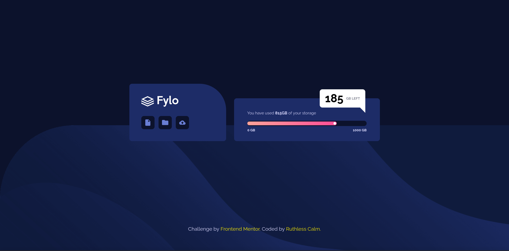
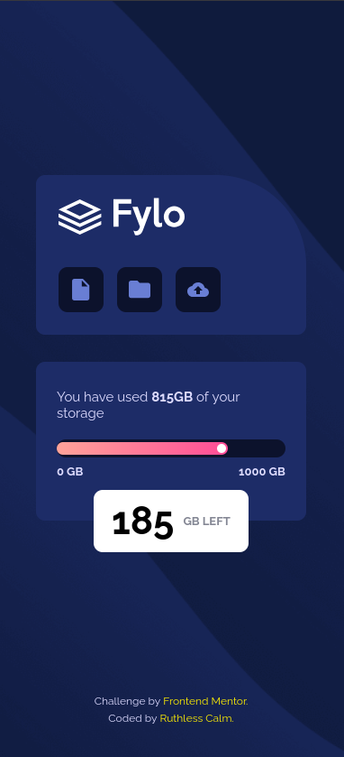

# Fylo Data Storage Component

This is one of my Frontend Mentor challenge projects.

## Links

This is the challenge - [Fylo Data Storage Component](https://www.frontendmentor.io/challenges/fylo-data-storage-component-1dZPRbV5n)

* Live Demo: [Fylo Data Storage Component](https://ruthlesscalm.github.io/fm-fylo-data-storage-component/)
* Solution: [Frontend Mentor Solution](https://www.frontendmentor.io/solutions/-built-to-impress-400400-accessibility-and-progress-bar-timeout-9ho8s2LCci)

## Preview

* **Desktop**

* **Mobile**

## Features

* Fully fluid and responsive layout (280px to 1920px)
* Accessibility-focused (semantic HTML, focus states, screen reader friendly)
* Progress bar animation using JavaScript

## Tech Stack

* HTML
* CSS
* JavaScript

## Credits / References

* [Piccalilli - Andy Bell](https://piccalil.li/author/andy-bell/)
  * [Modern CSS Reset](https://piccalil.li/blog/a-more-modern-css-reset/)

## License

This project is licensed under the MIT License.

Feel free to use the code for learning, experimentation, or reference.
